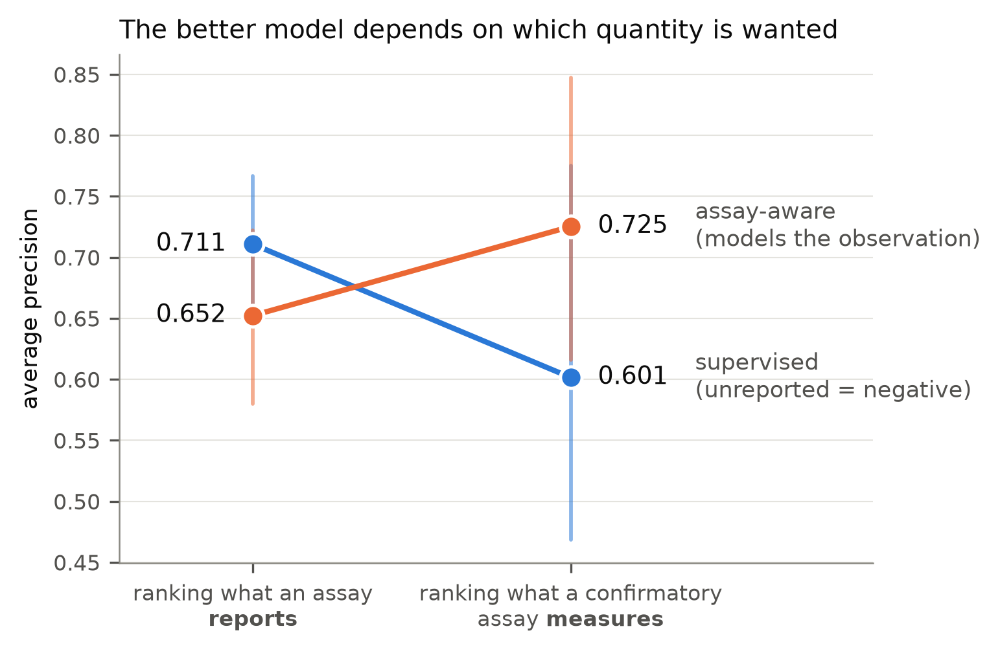
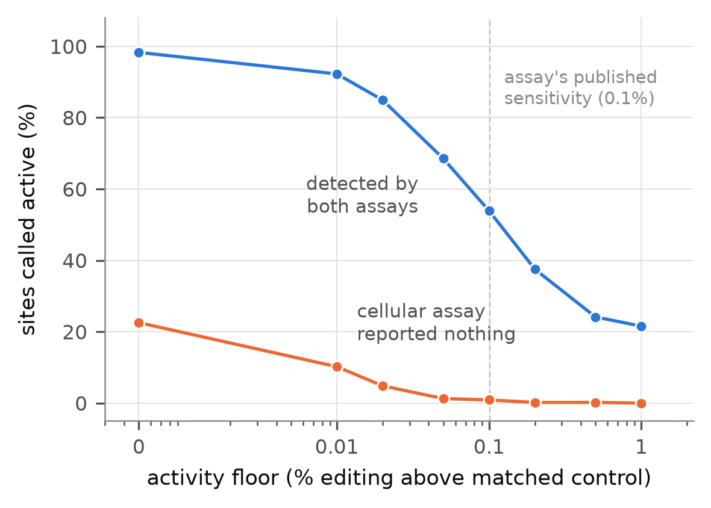
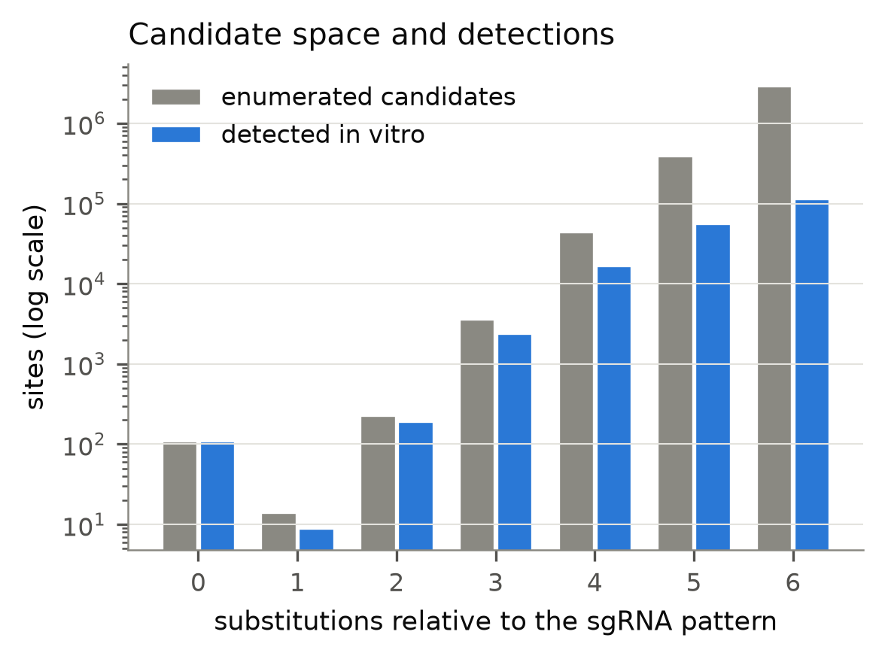

# AssayOT — assay-aware learning from incomplete labels for CRISPR–Cas9 off-targets

**"No cut reported" is not "no cut occurred."** CRISPR–Cas9 off-target predictors learn
from labels produced by detection assays that disagree with each other, and most
pipelines resolve that disagreement by declaring every unreported candidate a biological
negative — turning a statement about *what was observed* into one about *what happened*.

This repository asks what can actually be estimated from such data, and answers it with
measurements rather than assumptions.

<p align="center">
  
</p>

The central result is that **there is no single best model, because there is no single
quantity.** Ranking what an assay *reports* and ranking what a nuclease *does* are
different targets, and the ordering of methods reverses between them. The published
record contains far more of the first than the second.

## What the data actually support

| Question | Answer |
|---|---|
| Is "unreported" a safe negative? | **At the assay's own 0.1% sensitivity, yes** — only 0.9% of sites a cellular assay missed show real editing. Below that floor, up to 22.5% do. |
| Does modelling the observation process help? | **Only for the right target.** It costs 0.058 average precision at predicting reports and gains 0.124 at predicting measured activity. |
| Can activity and detection be separated? | **Only under a declared constraint.** Configurations fitting the reports equally well disagree more and more about activity as the detection branch is freed (36% → 44% → 59% spread). |
| Does it beat what practitioners already do? | **Not demonstrably.** Ranking by in-vitro read depth reaches 0.660 against the model's 0.725, and the gap is not significant on six sgRNAs (*p* = 0.079). |

### The number everyone quotes is a choice, not a finding

How much cellular activity hides among sites a cellular assay failed to report? It
depends entirely on how much activity you insist on seeing — and it moves 25-fold
across the plausible range.

<p align="center">
  
</p>

### Performance is claimed over a stated space, never over "the genome"

Every hg38 site within 6 substitutions of each sgRNA is enumerated exactly on the GPU —
6,765,936 candidates in 134 s, containing **100.0000%** of the released detections.
Detection is strongly non-uniform across that space, which is what the observation
branch has to represent.

<p align="center">
  
</p>

## Three traps in the public data, found while building this

- **A validation flag that is not a label.** A widely used database records `FALSE` both
  for a rejected off-target and for a failed PCR. Only 592 of 4,340 such rows carry a
  measurement that tells them apart.
- **Bulges hide in three different shapes** — a gap character, a 24-nt window with *no*
  gap character, and an empty sequence cell. Catching only the first leaves RNA-bulge
  rows masquerading as substitution sites with 7+ spurious mismatches.
- **One sgRNA, 14,833 identical loci.** A single off-target sequence recurs across a
  repeat family, so pooling by coordinate lets one guide supply tens of thousands of
  apparently independent rows. Splits are made on sequence, never on locus.

## Layout

| Path | Content |
|---|---|
| `src/config.py` | paths and the frozen scope (SpCas9, human, hg38, substitutions only) |
| `src/prep.py` | harmonises the CHANGE-seq supplementary tables and CRISPRoffT into a two-table, provenance-aware benchmark + `PROVENANCE.md` |
| `src/scan.py` | GPU enumeration of the candidate space: every hg38 site within 6 substitutions of each sgRNA pattern, both strands |
| `src/encode.py` | sequence-pair encoding and pre-assay tabular features |
| `src/model.py` | shared pair encoder, per-context activity heads, capacity-constrained observation branch |
| `src/experiment.py` | sgRNA clustering, splits, the validation-selection model, training loop |
| `src/baselines.py` | mismatch count, position-weighted score, published CFD |
| `src/metrics.py` | per-sgRNA ranking, macro-averages, guide-level bootstrap, calibration, risk–coverage |
| `src/run.py` | one protocol per subcommand |
| `src/figures.py`, `src/tables.py` | figures and LaTeX tables, generated from the result CSVs so the paper cannot drift from the numbers |
| `src/summary.py` | one-screen digest of every result file |
| `src/selfcheck.py` | asserts the invariants the paper's claims rest on; run it after `prep` and `scan` |
| `src/cfd_to_json.py` | one-off conversion of the published CFD pickles to JSON, behind a restricted unpickler |
| `results/` | metric CSVs, per-sgRNA rankings, the pre-registered `ANALYSIS_PLAN.md` with its amendments, and the generated `PROVENANCE.md`. Per-row predictions are included except `pred_guide.parquet` (234 MB, past GitHub's file limit); regenerate it with `python -m src.run guide`, which is deterministic given the frozen seed |

## The two tables

Splitting the data this way is the point, not a convenience. A pair seen by two
technologies is **two correlated observations**, not two independent samples.

`pairs_v1.parquet` — one row per biological entity (sgRNA × genomic site):
`pair_id`, `guide_sequence`, `site_sequence`, `chromosome`, `start`, `end`, `strand`,
`genome_build`, `n_mismatch`, `mismatch_pattern`, `has_bulge`, `seq_key`.

`observations_v1.parquet` — one row per observation of a pair in one assay:
`pair_id`, `study_id`, `assay_id`, `assay_type`, `context`, `cell_type`, `nuclease`,
`replicate_id`, `status`, `evidence_tier`, `signal_value`, `coverage`, `qc_status`.

`status` is drawn from a four-value vocabulary, and nothing collapses it:

| status | meaning |
|---|---|
| `reported_positive` | the assay reported this site |
| `tested_negative` | the site was interrogated and the signal fell below a **stated** limit of detection |
| `unobserved` | not reported by this assay; unknown, **not** a negative |
| `uninterpretable` | assay or PCR failure, QC fail |

`evidence_tier` is kept separate from `status`, because a site confirmed by a targeted
assay is stronger evidence than a discovery-assay detection and the two must not be
pooled into one positive class.

## Data

Nothing is redistributed here. `src/config.py` reads a local folder from
`ASSAYOT_DATA`; see `datasets/MANIFEST.md` in that folder for the full inventory,
sizes and checksums.

```bash
D="$ASSAYOT_DATA"

# CHANGE-seq supplementary tables (Lazzarotto et al. 2020)
mkdir -p "$D/crispr_changeseq" && curl -L -o \
  "$D/crispr_changeseq/41587_2020_555_MOESM3_ESM.xlsx" \
  "https://static-content.springer.com/esm/art%3A10.1038%2Fs41587-020-0555-7/MediaObjects/41587_2020_555_MOESM3_ESM.xlsx"

# CRISPRoffT (Wang et al. 2025)
mkdir -p "$D/crispr_offt" && cd "$D/crispr_offt" && for f in \
  allframe_update_addEpige.txt Each_tech_statistics_update.csv \
  Each_guide_statistics_update.csv; do
  curl -LO "https://ccsm.uth.edu/CRISPRoffT/table_summary/$f"; done

# hg38
mkdir -p "$D/reference_hg38" && curl -L -o "$D/reference_hg38/hg38.fa.gz" \
  "https://hgdownload.soe.ucsc.edu/goldenPath/hg38/bigZips/hg38.fa.gz"

# CFD lookup tables (Doench et al. 2016). They circulate as protocol-0 pickles;
# convert once behind a restricted unpickler so nothing unpickles third-party
# data at run time. The converter and the loader both assert the published values.
mkdir -p "$D/cfd" && cd "$D/cfd" && for f in mismatch_score.pkl pam_scores.pkl; do
  curl -LO "https://raw.githubusercontent.com/mahmudhera/kRISP-mER/master/kRISP-meR_source/krispmer/CFD_scoring/$f"; done
cd - && .venv/bin/python -m src.cfd_to_json
```

## Reproduce

```bash
uv venv --python 3.12 .venv
uv pip install --python .venv/bin/python torch --index-url https://download.pytorch.org/whl/cu130 \
    --extra-index-url https://pypi.org/simple --index-strategy unsafe-best-match
uv pip install --python .venv/bin/python -r requirements.txt

.venv/bin/python -m src.run prep        # harmonise  -> PROVENANCE.md
.venv/bin/python -m src.run scan        # candidate space (GPU, ~2.5 min)
.venv/bin/python -m src.selfcheck       # assert the invariants hold
.venv/bin/python -m src.run guide       # unseen sgRNA
.venv/bin/python -m src.run validated   # confirmatory assay, leave-one-sgRNA-out
.venv/bin/python -m src.run study       # unseen study
.venv/bin/python -m src.run tech        # unseen technology
.venv/bin/python -m src.run semisynth   # masking with a known mechanism
.venv/bin/python -m src.run prior       # PU class-prior sensitivity
.venv/bin/python -m src.run identify    # identifiability / sensitivity
.venv/bin/python -m src.figures && .venv/bin/python -m src.tables
```

## Licence

MIT for the code (`LICENSE`). The underlying data remain under the licences of their
original publications; see `datasets/MANIFEST.md`.

## Manuscript

The manuscript itself is **not distributed here**, to avoid any conflict with the
target journal's prior-publication policy. This repository contains everything needed
to reproduce the work — the harmonised benchmark, the candidate space, the model, the
analysis plan and all result tables — and the paper will be linked here once published.

## How to cite

If you use the code or the harmonised benchmark, please cite the paper (see
`CITATION.cff`, which GitHub renders as a citation widget):

> Malekpouri M., Lotfi S. *Assay-aware learning from incomplete labels for cross-study
> CRISPR--Cas9 off-target prediction.*

Repository: <https://github.com/malekpouri/AssayOT>
